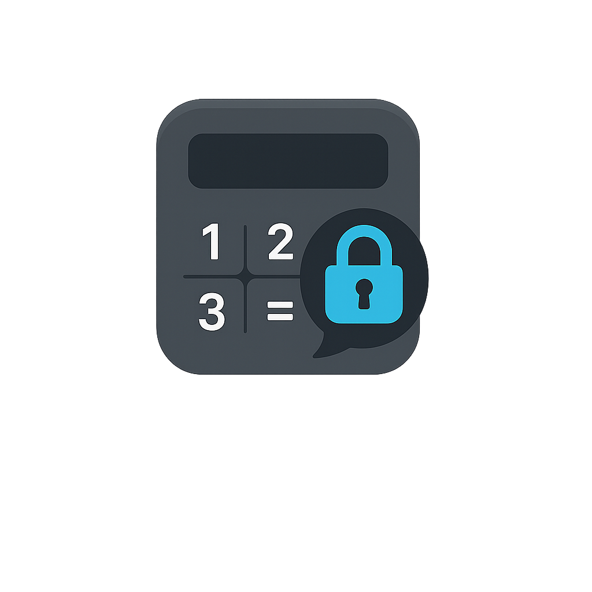

<p align="center">
    
</p>

<p align="center">
    <h1 align="center">HarpoChat</h1>
</p>

<p align="center">
    <em><code>❯ Discreet end‑to‑end encrypted chat disguised as a full‑featured scientific calculator</code></em>
</p>

<p align="center">
    
    
    
    
</p>

<p align="center">
    <em>Developed with the tools below.</em>
</p>

<p align="center">
    
    
    
    
    
    
    
</p>

---

## 🔗 Table of Contents

- [🔗 Table of Contents](#-table-of-contents)
- [📍 Overview](#-overview)
- [🧙 Name Origin](#-name-origin)
- [👾 Features](#-features)
- [📁 Project Structure](#-project-structure)
- [🚀 Getting Started](#-getting-started)
  - [☑️ Prerequisites](#️-prerequisites)
  - [⚙️ Installation](#️-installation)
  - [🤖 Usage](#-usage)
- [🧪 Future Testing](#-future-testing)
- [📌 Project Roadmap](#-project-roadmap)
- [🔰 Contributing](#-contributing)
- [🎗 License](#-license)

---

## 📍 Overview

**HarpoChat** is an Android application that hides an encrypted messenger behind a **fully working scientific calculator**. The app installs as *Calculator*, opens as a calculator, and only reveals the private space when the user types their secret code and **long-presses `=`**. A second, *duress* code silently and irreversibly wipes everything.

There are **no default codes**: on first launch the user chooses both codes. They are never stored — they are stretched (PBKDF2) and bound to the phone's secure hardware (Android Keystore, StrongBox when available) to derive the key that encrypts the local database (SQLCipher). Without the code **and** the physical phone, the data is unreadable.

Networking (a zero-knowledge relay mesh) is developed in the separate `HarpoChat_Serveur` repository; see [`docs/SERVER_SPEC.md`](docs/SERVER_SPEC.md). The app embeds the shared Rust core (`harpochat-core`, updated with `scripts/update-core.sh`) and, while unlocked, keeps an authenticated link to the mesh (TLS + Noise, node identity checked against embedded roots) with Poisson cover traffic and loop measurements. Message delivery over the mesh is the next step; until then, conversations are simulated locally.

---

## 🧙 Name Origin

The name **HarpoChat** pays homage to **Harpocrates**, the Greco‑Roman god of silence and secrets.  Greeks and Romans interpreted statues of the Egyptian child‑god **Horus** holding a finger to his lips as a gesture of secrecy.  This misunderstanding transformed Harpocrates into a deity representing confidentiality and discreet communication.  Naming the project after Harpocrates underscores its focus on keeping conversations hidden and private.

---

## 👾 Features

- 🎨 **« Silence » design** – ink black with a single mint accent, Manrope and Inter fonts embedded in the APK (no request to Google Fonts), vector stroke icons only, a circular reveal from the `=` key on unlock. See [`docs/design/2026-11-27-silence-design.md`](docs/design/2026-11-27-silence-design.md).
- ⏳ **Ephemeral messages** – per-conversation lifetime (1 h, 24 h, 7 days); expired messages are securely deleted.
- 🧮 **Credible façade** – complete scientific calculator (memory keys, trigonometry, powers, roots, factorial, scientific notation), generic calculator icon, neutral package id (`app.calc.scientific`), no camera permission.
- 🔐 **Hardware-bound encryption** – database key = AES-GCM-wrapped, unwrapped only with `HMAC_Keystore(PBKDF2(code))`. No hash of the secret code is ever stored; every guess must go through the phone's secure hardware.
- 🧨 **Silent duress wipe** – crypto-shredding (Keystore key destroyed) + database, preferences and caches deleted. Discreet confirmation: double vibration, display reset to `0`, no text.
- 🔒 **Automatic lock** – the private space closes (database closed, key zeroed) as soon as the app leaves the screen.
- 🙈 **Screen protection** – screenshots and screen recording blocked while unlocked, no thumbnail in Recents, incognito keyboard (no personalised learning) in sensitive fields.
- 🤝 **Consent-only contacts** – signed, expiring QR invitations scanned by the system scanner (the app never touches the camera), with a verification code to compare.
- 🚫 **Nothing leaves the device** – cloud backup and device-to-device transfer excluded.
- ✅ **Tested & automated** – unit tests (calculator engine, key vault, PIN policy, invitations) and GitHub Actions: build + tests + lint on every PR, signed APK published on every `v*` tag.

---

## 📁 Project Structure

```text
app/src/main/java/app/calc/scientific/   # neutral package name (same as the applicationId)
├── CalcApp.kt             # Application: single AppLock instance, locks on background
├── MainActivity.kt        # Single activity: setup → calculator (locked) → private space
├── calculator/            # CalcEngine (pure Kotlin), ViewModel, screen
├── security/              # Vault (key derivation), KeyBinder (Keystore), AppLock, PinPolicy
├── data/                  # Room + SQLCipher database, repository
├── setup/                 # First-launch screen (choose both codes)
├── messaging/             # Conversations, chat, QR / pairing-code screens
├── settings/              # Display name, change codes, security status
├── navigation/            # Private-space navigation graph
├── link/                  # Signed invitation format (transitional, replaced by harpochat-core)
├── net/                   # Mesh link: trust roots, TLS + Noise link, cover traffic, loops
└── ui/                    # Theme, chat components, privacy helpers
app/src/main/java/org/corekit/          # generated bindings of the shared Rust core (scripts/update-core.sh)
docs/
├── SERVER_SPEC.md         # Client ↔ server contract (zero-knowledge mesh)
├── server/              # Integration notes from the server team
└── design/              # Design documents
```

---

## 🚀 Getting Started

### ☑️ Prerequisites

To build and run **HarpoChat** you will need:

- **JDK 17** – the project targets Java 17.
- **Android Studio Hedgehog** or later, or the command‑line **Gradle** wrapper.
- **Android SDK** – `compileSdk` is 36 and `minSdk` is 28 (Android 9).
- A device or emulator running **Android 8.0 (API 26)** or higher.

### 📲 Download

Every merge into `main` publishes a new signed APK in the [GitHub Releases](https://github.com/Cronix2/HarpoChat/releases) (`calculator-v1.0.N.apk`), with its SHA-256 checksum. Check it before installing:

```sh
sha256sum -c calculator-v1.0.N.apk.sha256
```

The app is distributed outside the Play Store: allow installation from your browser or file manager when Android asks.

### ⚙️ Installation

Clone the repository and build the app:

```sh
git clone https://github.com/Cronix2/HarpoChat.git
cd HarpoChat
./gradlew assembleDebug
```

The debug APK will be generated in `app/build/outputs/apk/debug/`.

### 🤖 Usage

1. **First launch.** Choose a secret code and a wipe code (6–12 digits, different, not trivial). This screen never appears again.
2. **Everyday use.** The app looks and works like a calculator.
3. **Open the private space.** Type the secret code, then **long-press `=`**.
4. **Lock.** Leave the app, press back on the conversation list, or tap the lock icon: you are back on the calculator.
5. **Emergency.** Type the wipe code, then long-press `=`: everything is destroyed, a double vibration confirms it.

*Debug builds only:* Settings › *Démonstration* creates sample conversations, and `adb shell setprop debug.calc.capture 1` allows screenshots for documentation.

---

## 🧪 Testing

```sh
./gradlew :app:testDebugUnitTest   # calculator engine, key vault, PIN policy, invitations
./gradlew :app:lintDebug
```

---

## 📌 Project Roadmap

- **True End‑to‑End Encryption:** Integrate the existing `SignalCryptoEngine` with the new database layer so that plaintext messages are never stored; encrypt/decrypt messages on send/receive.
- **Real Networking:** Replace the network simulator with actual peer‑to‑peer or server‑mediated message exchange.
- **Conversation Creation & Management:** Add UI and logic to create new threads, manage contacts and group chats.
- **Secure PIN Configuration:** Provide a settings screen to change the secret and duress PINs and to configure biometric unlock.
- **Rich Media & Attachments:** Support sending images, files and voice messages.

---

## 🔰 Contributing

Contributions are welcome!  To contribute:

1. **Fork** the repository on GitHub.
2. **Clone** your fork:

   ```sh
   git clone https://github.com/<your-username>/HarpoChat.git
   cd HarpoChat
   ```
3. **Create a new branch** for your feature or fix:

   ```sh
   git checkout -b your-feature-name
   ```
4. **Make your changes** and commit them with clear messages:

   ```sh
   git commit -m "Add awesome feature"
   ```
5. **Push** the branch to your fork:

   ```sh
   git push origin your-feature-name
   ```
6. **Open a Pull Request** describing your changes and why they should be merged.

Please follow the existing code style and include tests where relevant.  For major changes, open an issue first to discuss your proposal.

---

## 🎗 License

This project is licensed under the **MIT License**.  See the [LICENSE](./LICENSE) file for details.

---

🚀 **Thank you for exploring HarpoChat!**  If this project sparks ideas for privacy‑focused communication or hidden apps, please consider starring the repository and sharing your feedback.
